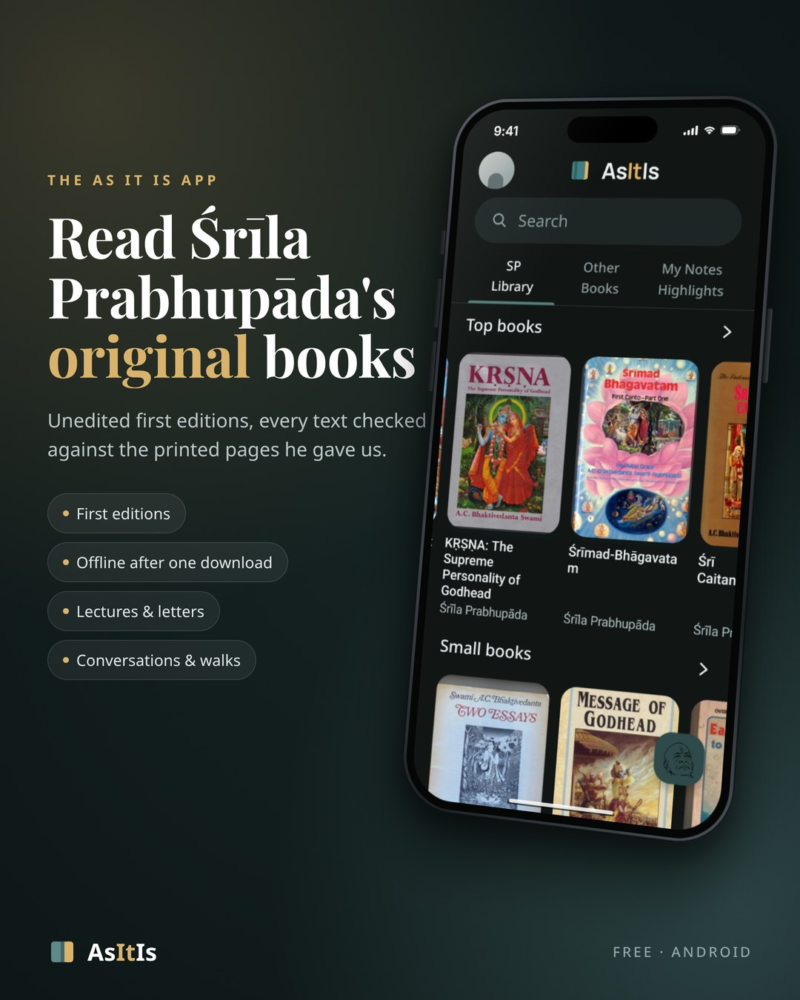

## ✨ As It Is {{VERSION}}

**Śrīla Prabhupāda's original books, as they were first printed.**

{{APK_MB}} MB · one file for every Android phone · free

---

### 📚 Inside

- 📖 **The original books**, every text checked against the first-edition prints
- 🎧 **Over 4,000 lectures, conversations and morning walks**, nearly all with Śrīla Prabhupāda's original audio
- ✉️ **6,898 letters**, over 5,000 with their original typed pages
- 🌅 **A Day with Śrīla Prabhupāda**: what he said, wrote and did on today's date
- 🖍️ **Highlights, notes and bookmarks**, a built-in dictionary, English → Hindi translation
- 🔎 **One search** across books, letters, talks and your highlights
- 🌙 **Light, dark or pure black**, and an e-book mode that reads page by page

### 📥 Install

1. Download **`AsItIs-v{{VERSION}}.apk`** (the button above, or under *Assets* below).
2. Open it and allow the install.
3. On its first start the app downloads the library once (about **{{LIBRARY_MB}} MB**, Wi-Fi recommended). After that it works **without internet**.

Needs Android 7.0 or newer. If an older As It Is is installed and this one does not install over it, uninstall the old one first.
