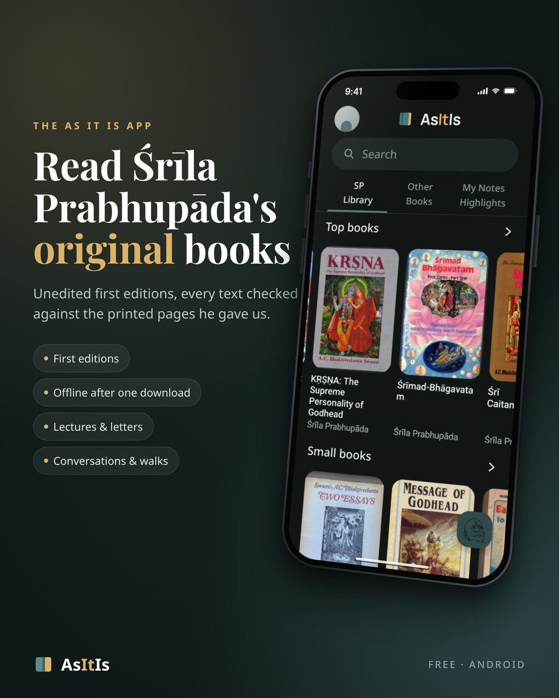
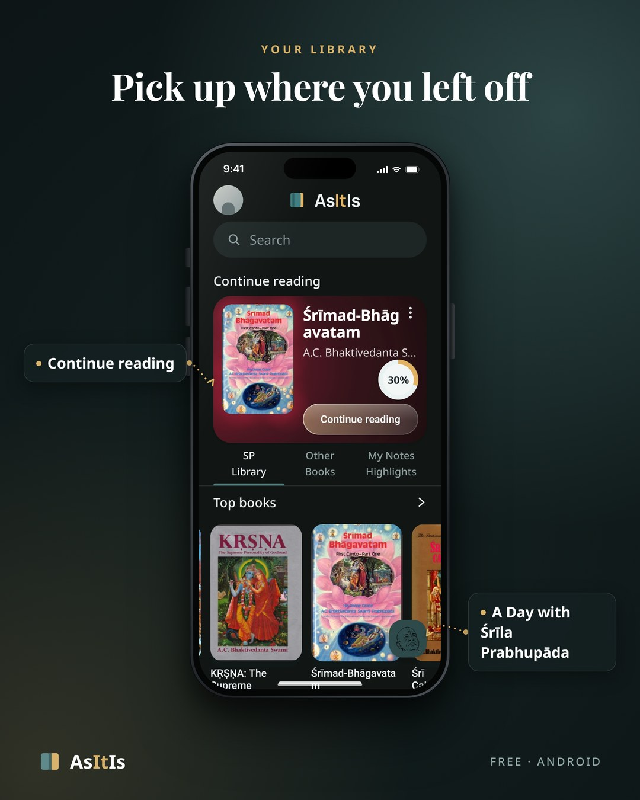
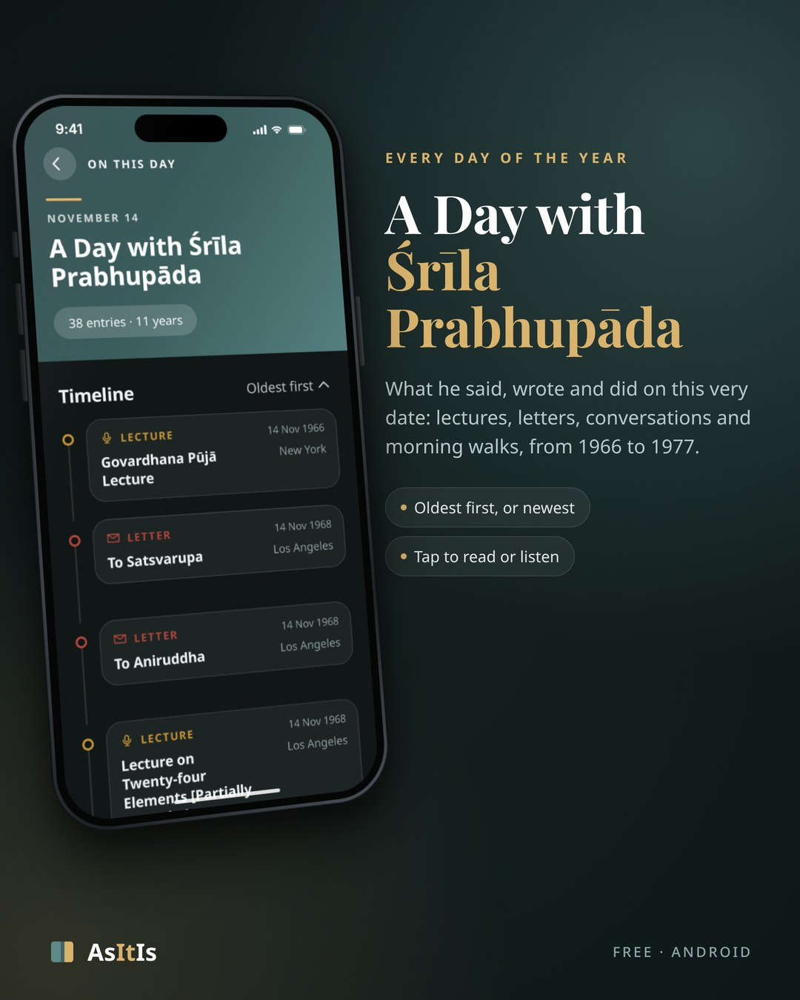
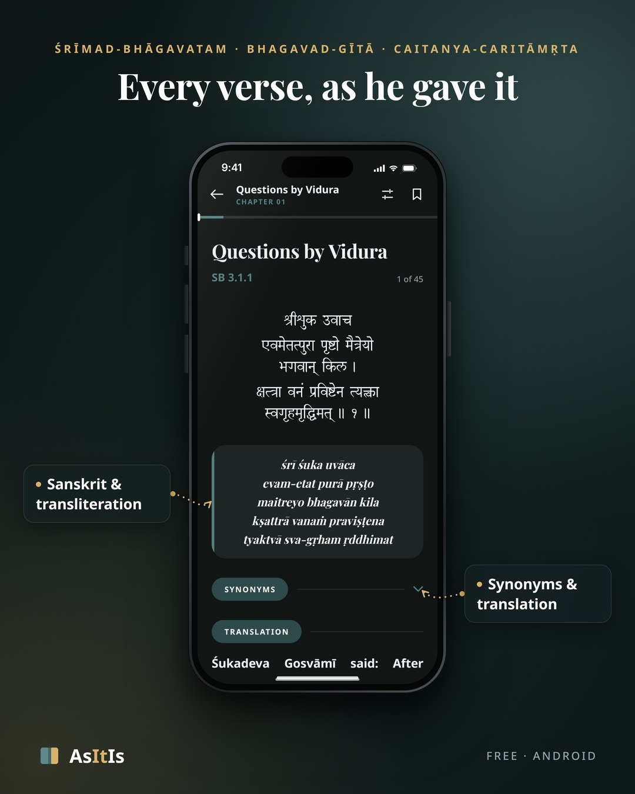
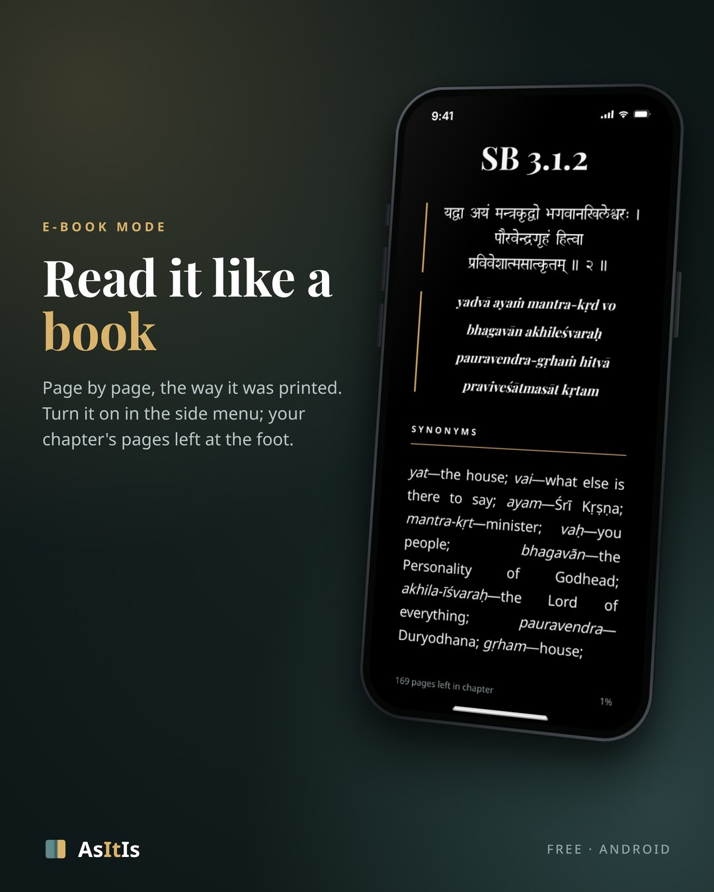
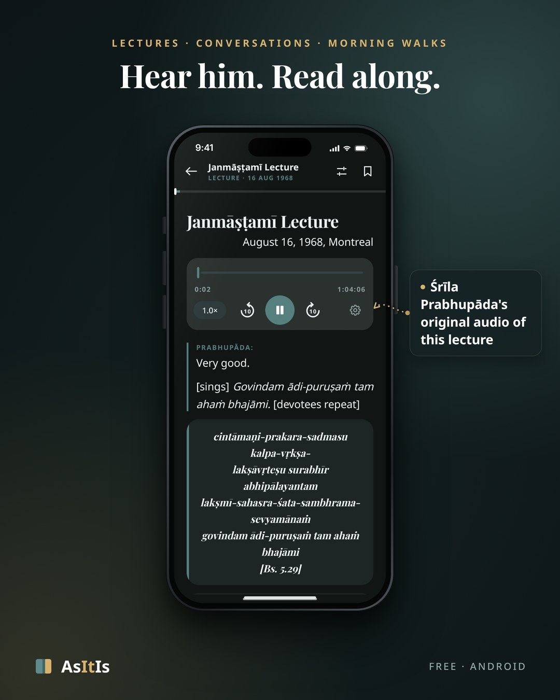
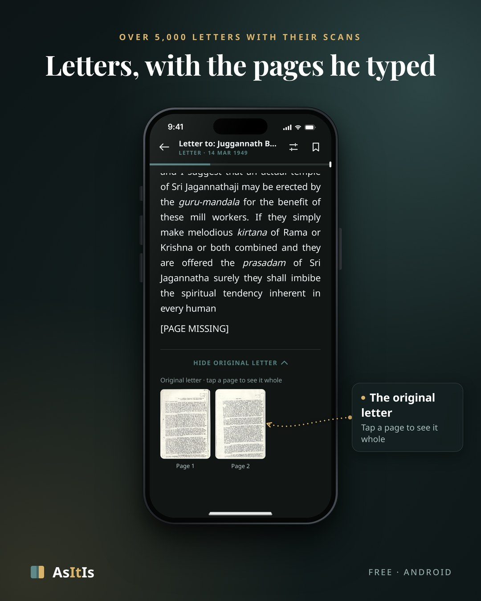
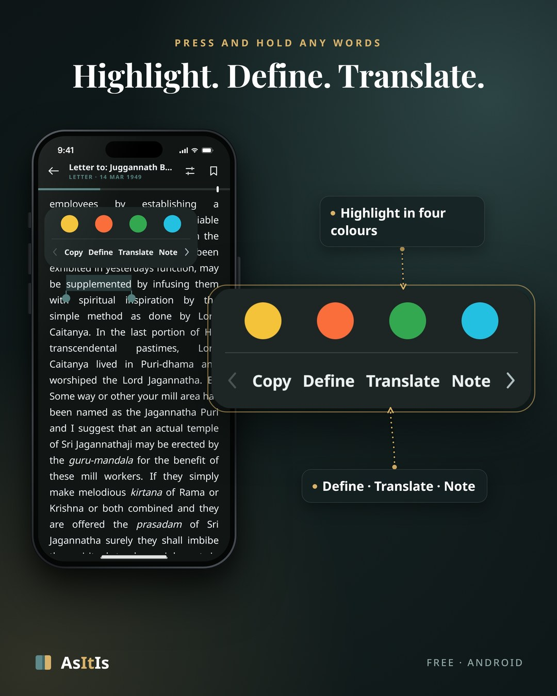
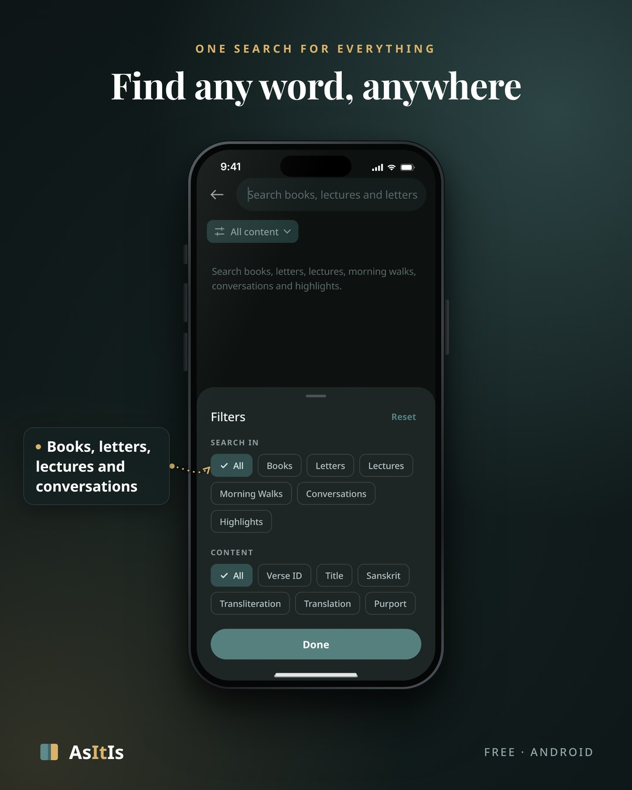
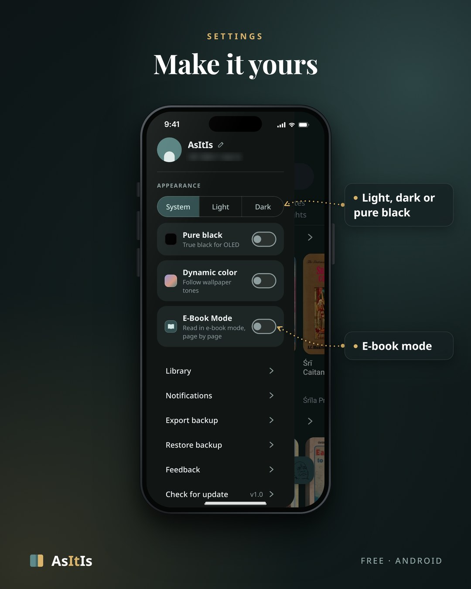

## ✨ As It Is {{VERSION}}

**Śrīla Prabhupāda's original books, as they were first printed.**

{{APK_MB}} MB · one file for every Android phone · free

---

### 🆕 New in {{VERSION}}

**🎵 Music: Śrīla Prabhupāda singing**
- 143 recordings of Śrīla Prabhupāda's songs and their purports, listed A–Z, with a search at the top.
- A full-screen player with a wavy seek bar; its top-left button shrinks it into the mini player, and a tap or swipe up on the mini player opens it again.
- Favorites and your own playlists, with drag-to-reorder. Shuffle, repeat, autoplay, and a sleep timer that fades out.
- Download any song to play it with no internet. New songs appear in the list without a new app.

**🎧 Lectures, conversations and morning walks**
- A mini player keeps the recording going while you move around the app. It remembers what you were playing after a restart, and a tap takes you back to your place in the talk.
- **Downloads**: every recording and song kept on the phone, newest first. Remove any with one tap.
- **Finished talks** get a green tick in the lists. The app asks "Have you finished it?" when you leave a talk you read or listened to, including one played from Downloads. Long-press a talk, or tap its tick, to mark or unmark it.
- **Bhagavad-gītā, Śrīmad-Bhāgavatam and Śrī Caitanya-caritāmṛta lectures** are listed chapter by chapter, verse after verse. Filter them by chapter or by verse, or switch to date order.

**🔎 Search**
- One list of results across books, letters, talks, songs and your highlights.
- Find a talk by its code (for example 750713BG).
- Search inside the book you are reading, or just the page you are on. Step through every match; the page no longer jumps.
- A book's own search shows only the filters that suit that book.
- Highlights search ignores diacritics ("krsna" finds Kṛṣṇa). The keyboard steps aside when you open a filter or tap elsewhere.

**📖 Reading**
- Continue reading keeps your place. A book opened again from the Library moves its saved place only after 5 minutes of reading.
- Back from a book opened through Continue reading goes to its contents, with the verse or chapter you were on in view.
- Clearer contents pages, a Starting content section, and speaker labels on verses ("Sañjaya said").
- E-book mode: true full screen and better margins and headings. Headings grow with the font size.

**🔄 Updates without a new app**
- Corrected books arrive with a short notice; new recordings, letters' originals and songs arrive quietly. No new app is needed for either.
- An app update is now offered on whichever screen you are on.

### 📚 Inside

- 📖 **The original books**, every text checked against the first-edition prints
- 🎧 **Over 4,000 lectures, conversations and morning walks**, nearly all with Śrīla Prabhupāda's original audio
- ✉️ **6,898 letters**, over 5,000 with their original typed pages
- 🎵 **Śrīla Prabhupāda's singing**, to stream or keep on the phone
- 🌅 **A Day with Śrīla Prabhupāda**: what he said, wrote and did on today's date
- 🖍️ **Highlights, notes and bookmarks**, a built-in dictionary, English → Hindi translation, backup and restore
- 🌙 **Light, dark or pure black**, and an e-book mode that reads page by page

   
   

### 📥 Install

1. Download **`asitis.apk`** (the button above, or under *Assets* below).
2. Open it and allow the install. It installs over As It Is 1.0 and keeps your highlights, notes and places.
3. On its first start the app downloads the library once (about **{{LIBRARY_MB}} MB**, Wi-Fi recommended). After that it works **without internet**. Recordings and songs stream unless downloaded.

Needs Android 7.0 or newer. If an older As It Is is installed and this one does not install over it, uninstall the old one first.
