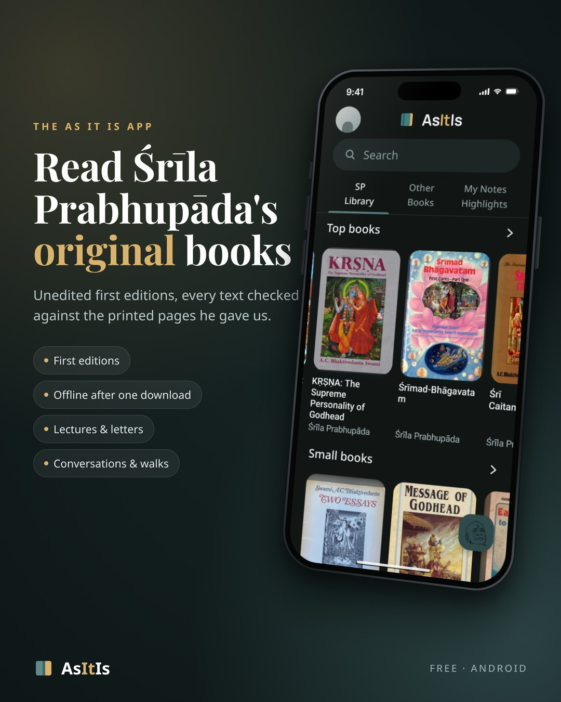
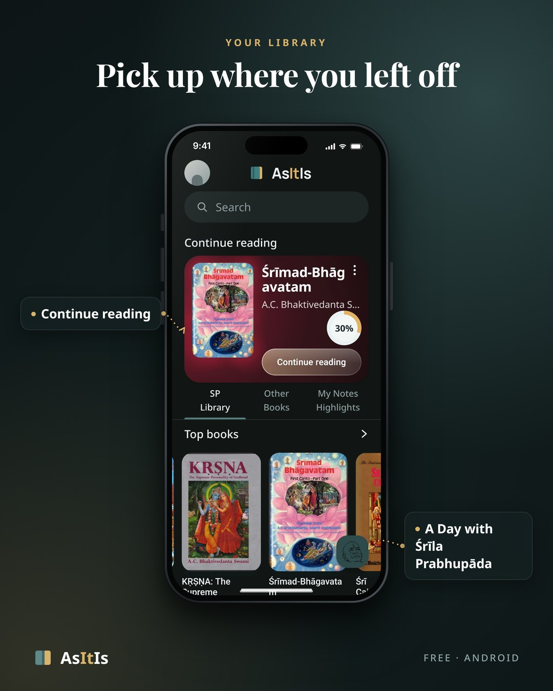
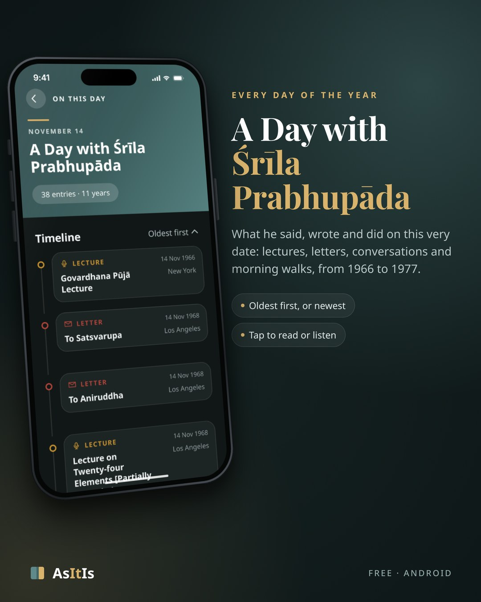
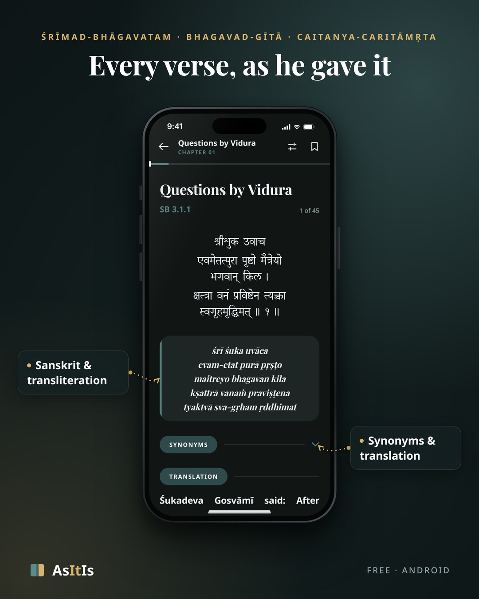
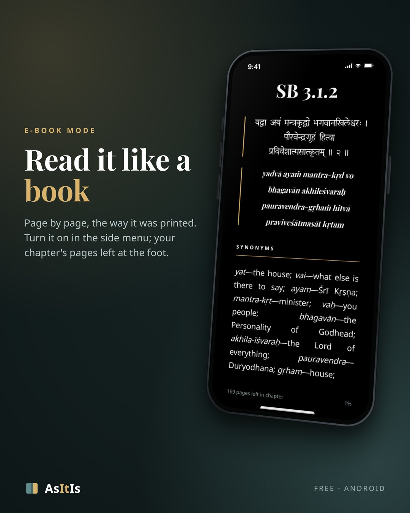
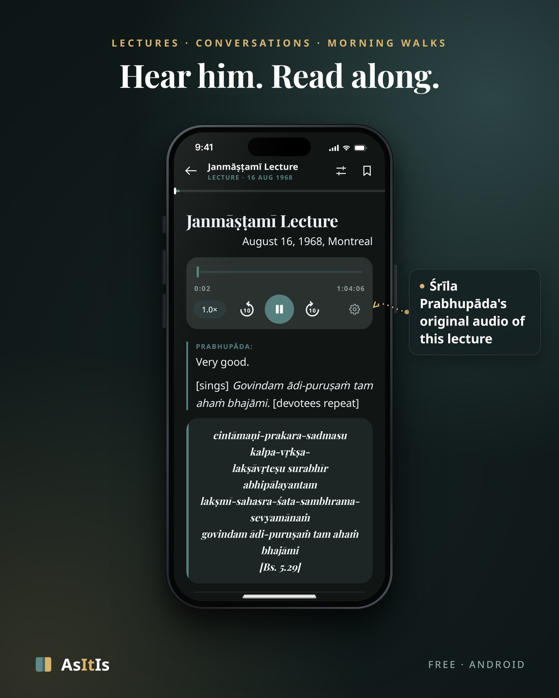
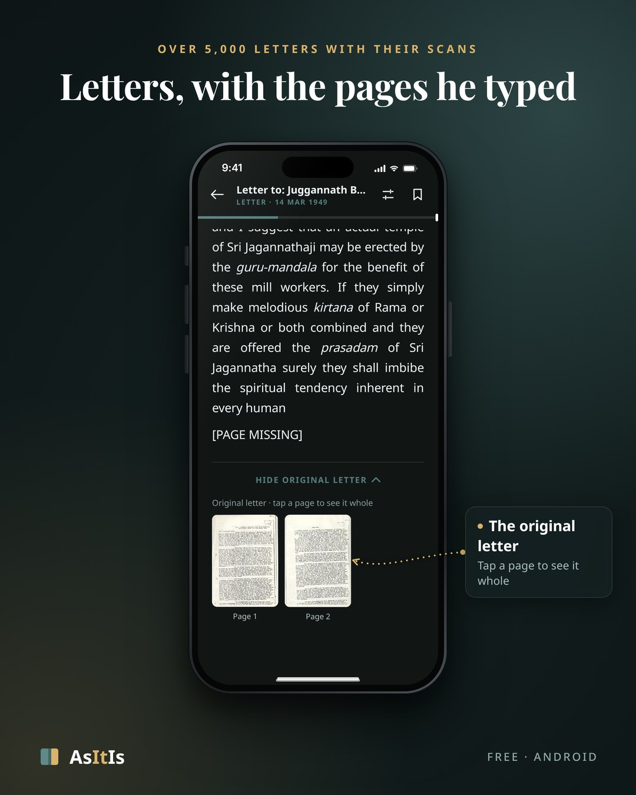
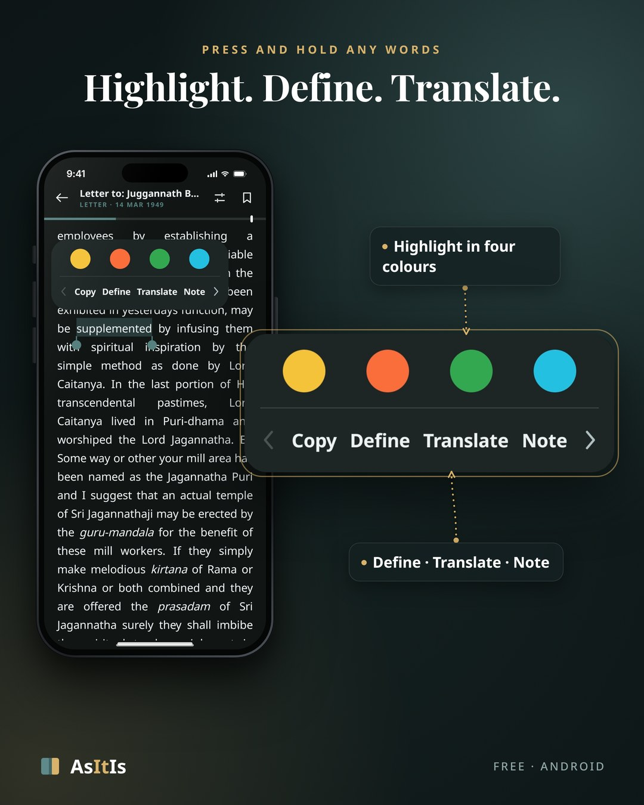
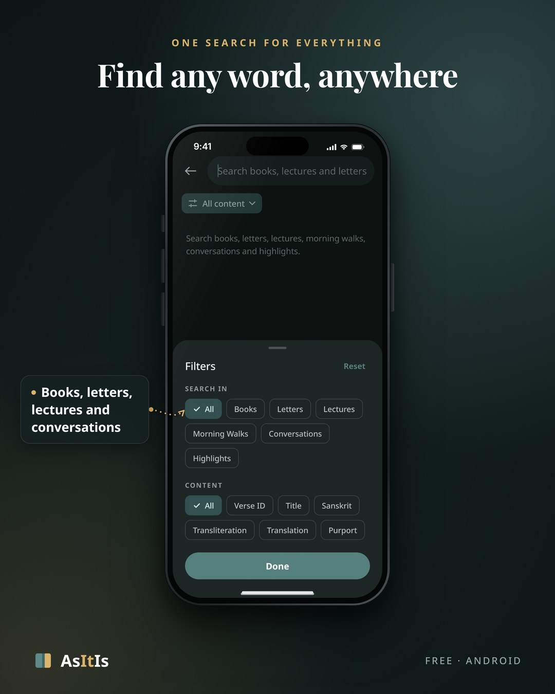
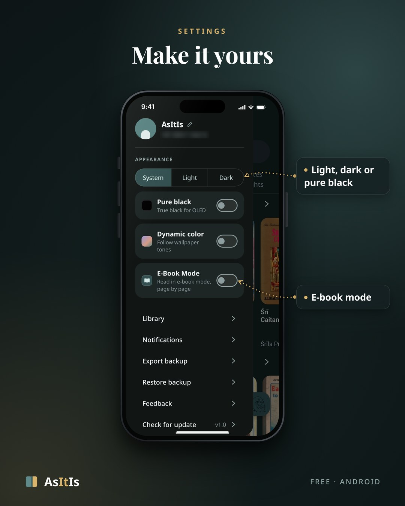

# As It Is

### Śrīla Prabhupāda's original books, as they were first printed

A dedicated initiative to preserve and present the original teachings of
His Divine Grace A. C. Bhaktivedanta Swami Prabhupāda. Every text in the app is
checked against the original scanned first editions.

&nbsp;

Free · Android 7.0 or newer · works offline after one download

---

## Inside the app

<table>
<tr>
<td width="50%" valign="top" align="center">
 
<b>Pick up where you left off</b> 
Your book and page, one tap away.
</td>
<td width="50%" valign="top" align="center">
 
<b>A Day with Śrīla Prabhupāda</b> 
His lectures, letters, conversations and walks from today's date, 1966 to 1977.
</td>
</tr>
<tr>
<td width="50%" valign="top" align="center">
 
<b>Every verse, as he gave it</b> 
Devanāgarī, transliteration, synonyms, translation and purport.
</td>
<td width="50%" valign="top" align="center">
 
<b>Read it like a book</b> 
E-book mode: page by page, the way it was printed.
</td>
</tr>
<tr>
<td width="50%" valign="top" align="center">
 
<b>Hear him. Read along.</b> 
Over 4,000 lectures, conversations and morning walks; nearly all with his original audio.
</td>
<td width="50%" valign="top" align="center">
 
<b>Letters, with the pages he typed</b> 
6,898 letters; over 5,000 with their original scans.
</td>
</tr>
<tr>
<td width="50%" valign="top" align="center">
 
<b>Highlight. Define. Translate.</b> 
Highlights in four colours, notes, a built-in dictionary, English → Hindi.
</td>
<td width="50%" valign="top" align="center">
 
<b>Find any word, anywhere</b> 
One search across books, letters, talks and your highlights.
</td>
</tr>
<tr>
<td width="50%" valign="top" align="center">
 
<b>Make it yours</b> 
Light, dark or pure black; dynamic colour; backup and restore.
</td>
<td width="50%" valign="middle" align="center">
<h3>📥 Get the app</h3>
<a href="https://app.asitis.cc/apk/AsItIs-v1.0.apk"><b>Download AsItIs-v1.0.apk</b></a> 
or from <a href="https://github.com/rushhour8/AsItIs-Releases/releases/latest">GitHub Releases</a>  
On its first start the app downloads the library once (Wi-Fi recommended); after that, no internet is needed.
</td>
</tr>
</table>

---

## Files the app reads

These files are read by the installed app. Please do not rename or delete them.

| File | What it is |
|---|---|
| `update.json` | The latest version (the app offers it as an update) |
| `notification.json` | Notices shown in the app |
| `share.json` | The text *Share app* shares |
| `policy.json` | The privacy policy |
| `library/` | The books the app downloads on its first start (encrypted; also served from https://library.asitis.cc/, which the app tries first) |

Contact: <a href="mailto:support@asitis.cc">support@asitis.cc</a> · Some lecture transcripts and recordings: <a href="https://vanisource.org">Vanisource</a>

